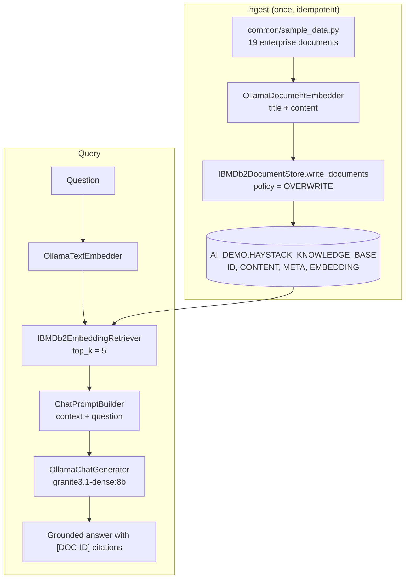

# UC01 - Enterprise Knowledge Assistant

> **Framework:** Haystack · **Db2 integration:** official [`ibm-db-haystack`](https://github.com/deepset-ai/haystack-core-integrations/tree/main/integrations/ibm_db) · **Pattern:** RAG

## Status

Implemented and verified end-to-end against a live IBM Db2 (Python 3.11, `ibm-db-haystack` 1.0.0, `haystack-ai` 3.4.1, `ollama-haystack` 7.0.2):

- 19 documents ingested, 768-dimension vectors, 0 rows without an embedding.
- Retrieval evaluation: hit rate 100%, MRR 1.000 on the 3 labelled queries. A wider manual check of 13 queries (including paraphrases such as "how long to keep bank records") also gave hit@5 = 13/13 with the correct document at rank 1 every time.
- Every statement in `validation.sql` runs against the live table.
- An out-of-scope question ("policy on pizza parties") returns a one-line "could not find it" answer.
- Answer citations (`[DOC-ID]`) are LLM-generated and not guaranteed. An early prompt cited the wrong id (`POL-002` instead of `SUP-002`); the tagged `<document id="...">` context and explicit citation rules fixed it. The retrieval gate is the strict check.

---

## Why this use case exists

Employees across large organisations search for answers buried in internal policies, runbooks, technical documents and FAQs. Keyword search fails because the same concept is worded differently across documents. This use case shows IBM Db2's native `VECTOR` type acting as the knowledge store for a grounded assistant, with no separate vector database.

| Audience | Framing |
|---|---|
| Learning project | Build a Q&A system over a document corpus where every answer cites its source documents. |
| Enterprise | Replace intranet keyword search with a semantically grounded assistant that answers only from your own Db2-hosted knowledge. |

---

## What it demonstrates

| Capability | Detail |
|---|---|
| Framework | Haystack 2.x pipeline |
| Db2 document store | `IBMDb2DocumentStore` (`haystack_integrations.document_stores.ibm_db`) |
| Db2 retriever | `IBMDb2EmbeddingRetriever` (`haystack_integrations.components.retrievers.ibm_db`) |
| Db2 capability | Native `VECTOR(n, FLOAT32)` column, `VECTOR_DISTANCE(..., COSINE)`, `ORDER BY ... FETCH FIRST k ROWS` |
| Write semantics | `DuplicatePolicy.OVERWRITE` (Db2 `MERGE`), so ingestion is idempotent |
| Embeddings | Ollama `nomic-embed-text` (768 dimensions) via `OllamaDocumentEmbedder` / `OllamaTextEmbedder` |
| LLM | Ollama `granite3.1-dense:8b` via `OllamaChatGenerator` (local, no API key) |
| Prompting | `ChatPromptBuilder` with a "cite your sources, answer only from context" system prompt |
| Evaluation | Hit rate / MRR / precision@k (`common/evaluation.py`) plus citation and key-fact checks |

### Flow



---

## How the Db2 integration works

These details come from the official integration source and drive several design decisions here.

| Topic | Behaviour in `ibm-db-haystack` | Consequence for UC01 |
|---|---|---|
| Table layout | The store creates `id VARCHAR(512) PK`, `content CLOB(2M)`, `meta BLOB` (BSON), `embedding VECTOR(dim, FLOAT32)` | UC01 uses its own table, `HAYSTACK_KNOWLEDGE_BASE`. It must not share a table with the LangChain `DB2VS` use cases (such as UC09), which use a different layout. |
| Metadata | Stored as BSON in `meta`. Read back with `SYSTOOLS.BSON2JSON(meta)` | `validation.sql` uses `JSON_VALUE(SYSTOOLS.BSON2JSON(META), '$.field' ...)` instead of plain columns. |
| Score | `Document.score` is the **raw Db2 cosine distance** (lower = closer), not a similarity | Output prints both distance and `1 - distance` as a similarity. |
| Table creation | Lazy: created on first use. `recreate_table=True` drops it first | `--recreate` maps to this flag. |
| Vector dimension | Fixed at table creation (`embedding_dim`) | `ingest.py` checks the model's real output dimension against `EMBEDDING_DIM` and fails with a clear message. |
| Transactions | Autocommit is OFF. Writes commit explicitly, failures roll back | No manual transaction handling is needed. |
| Credentials | `Secret.from_env_var("DB2_USERNAME")` / `DB2_PASSWORD` | Credentials are never hard-coded or serialised. |
| Python | Requires Python **3.11+** (`haystack-ai>=2.28`, `ibm-db>=3.2.8`) | Repo-wide minimum is now 3.11. |
| Filters | Haystack filter dicts are translated to Db2 SQL (`FilterTranslator`) | Not used in UC01. Metadata filtering is UC02. |

---

## Scope

- Load the shared enterprise corpus from `common/sample_data.py` (19 documents across policies, technical docs, ADRs, incidents, support articles, runbooks, procurement and compliance).
- Embed each document, including its title, with Ollama `nomic-embed-text`.
- Store the documents in `AI_DEMO.HAYSTACK_KNOWLEDGE_BASE` with a native `VECTOR(768, FLOAT32)` column.
- Build a Haystack pipeline: embedder, `IBMDb2EmbeddingRetriever`, prompt builder, LLM.
- Accept a natural-language question and return an answer that cites document IDs.
- Print the top-k retrieved documents with Db2 distance and derived similarity.
- Evaluate on 3 labelled queries.

**Out of scope for UC01:** metadata filtering (UC02), reranking (UC05), agents (UC13+).

---

## Project structure

```text
01_enterprise_knowledge_rag/
├── README.md          this file
├── requirements.txt   ibm-db-haystack, haystack-ai, ollama-haystack, ibm-db, rich
├── config.py          settings + create_document_store() (IBMDb2DocumentStore factory)
├── ingest.py          corpus -> OllamaDocumentEmbedder -> write_documents(OVERWRITE)
├── pipeline.py        build_rag_pipeline() and ask()
├── main.py            CLI entry point
├── eval.py            3-query retrieval and generation evaluation
└── validation.sql     SQL to inspect the Db2 state independently
```

---

## Setup

```bash
# Python 3.11+ is required by ibm-db-haystack
python3.11 -m venv .venv && source .venv/bin/activate
pip install -r 01_enterprise_knowledge_rag/requirements.txt

cp .env.example .env        # repo root; then edit the DB2_* values
ollama pull nomic-embed-text
ollama pull granite3.1-dense:8b
```

Environment variables (repo-root `.env`, see [`.env.example`](../.env.example)):

| Variable | Purpose | Default |
|---|---|---|
| `DB2_HOST`, `DB2_PORT`, `DB2_DATABASE` | Db2 connection | none / `50000` / `BLUDB` |
| `DB2_USERNAME`, `DB2_PASSWORD` | Read by Haystack `Secret.from_env_var` | none |
| `DB2_SSL`, `DB2_SSL_CERT_PATH` | TLS | `false` |
| `HAYSTACK_DB2_TABLE` | Schema-qualified table for this store | `AI_DEMO.HAYSTACK_KNOWLEDGE_BASE` |
| `EMBEDDING_MODEL`, `EMBEDDING_DIM` | Must match each other | `nomic-embed-text` / `768` |
| `OLLAMA_BASE_URL`, `OLLAMA_MODEL` | Local LLM | `http://localhost:11434` / `granite3.1-dense:8b` |

No local Db2? The official integration ships a docker-compose file (`icr.io/db2_community/db2`, database `testdb`, user `db2inst1`, port `50000`). See its [README](https://github.com/deepset-ai/haystack-core-integrations/tree/main/integrations/ibm_db).

---

## How to try it

```bash
cd 01_enterprise_knowledge_rag

python main.py --ingest                     # first run: embed and load the corpus, then answer the 3 sample questions
python main.py                              # later runs: query only
python main.py --query "What is the travel policy for Europe?"
python main.py --recreate                   # drop and recreate the table, then re-ingest
```

The first run auto-ingests when the table is empty.

Sample questions:

- `What is the travel reimbursement policy for Europe?`
- `How do I troubleshoot a slow Db2 query?`
- `What is the data retention requirement for customer transactions?`

---

## How to test it

### 1. Functional test

```bash
python main.py --query "What is the travel policy for Europe?"
```

Expected:

- `POL-001` is the top retrieved document (the Europe policy ranks above the North America one).
- The answer mentions the €250 hotel cap and €75 meal allowance and cites `[POL-001]`.

Exact distances depend on the embedding model and are not fixed values.

### 2. Evaluation

```bash
python eval.py
```

| Query | Expected document | Key facts expected in the answer |
|---|---|---|
| Travel reimbursement policy for Europe | `POL-001` | `250`, `75` |
| Troubleshoot a slow Db2 query | `SUP-002` | `RUNSTATS`, `index` |
| Data retention for customer transactions | `POL-003` | `7 years` |

It reports hit rate, MRR and precision@5 for retrieval, then per-query citation, key-fact and faithfulness checks. The exit code is non-zero if any expected document is missing from the top 5. Answer wording is LLM-generated, so the generation checks are indicative and the retrieval gate is the strict one.

### 3. SQL validation

Run [`validation.sql`](validation.sql) in the IBM Db2 Developer Extension or any Db2 client. It confirms the row count, the metadata, the vector dimension, and runs a raw `VECTOR_DISTANCE` query that reproduces what the retriever does.

---

## Design notes

- **Idempotent ingestion:** the business `document_id` (for example `POL-001`) is the Haystack `Document.id`. With `DuplicatePolicy.OVERWRITE`, re-running ingestion updates rows instead of failing on the primary key.
- **Titles are embedded:** `meta_fields_to_embed=["title"]` adds the title to the embedded text, which helps region- and product-specific questions.
- **Grounded by construction:** the system prompt restricts the model to the retrieved context and requires `[DOC-ID]` citations. The context block carries each document's ID, so the citations are traceable to Db2 rows.
- **Deterministic generation:** `temperature=0` keeps answers repeatable for evaluation.
- **Separate tables per framework:** Haystack and LangChain Db2 integrations use different schemas, so each gets its own table.

## Limitations

- UC01 has no metadata filtering. Similar policies from different regions can appear together (UC02 addresses this).
- No vector index is created. At 19 documents an exact scan is fine. For large corpora, create a Db2 vector index (`CREATE VECTOR INDEX ... WITH DISTANCE COSINE`) and keep the metric the same as the store's `distance_metric`, otherwise the index is not used.
- `ARCHIVED` documents (for example the incidents) are retrievable here. Status-aware retrieval belongs to UC02/UC04.
- Faithfulness uses a keyword-overlap heuristic, not an LLM judge.

## Enterprise impact

Shows the complete path from enterprise knowledge stored in IBM Db2 to a grounded, citation-bearing AI assistant, using only the official Haystack integration. Documents, metadata and embeddings all stay inside Db2, with no external vector database.
